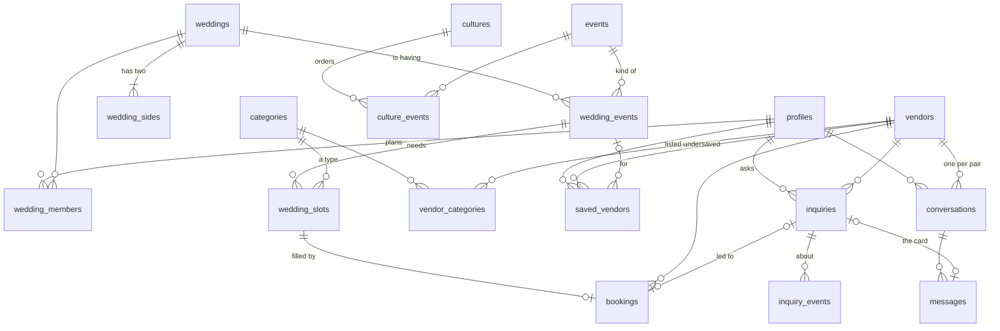

# The database

Postgres on Supabase, 80 tables in `public`, built by the migrations in `supabase/migrations/`. This page is the map: the core on one diagram, then every table in one line. The one-liners are the tables' own `comment on table` text, so the database is the source of truth; refresh this page with the query at the bottom.

## The core

Fourteen tables carry the app. A family plans a **wedding** made of **events**; each event needs vendor types (**slots**) and gets a **booking** when one is chosen. Families find **vendors**, **save** them, **ask** them (an inquiry) and talk to them in a **conversation**. Everything else hangs off these.



Keys: the reference tables (`events`, `categories`, `cultures`, `cities`, …) are keyed by a readable **slug** that also appears in deep links (`/v/royal-orchard`, `/e/mehndi`). Everything a person creates has a **uuid** id. People are `auth.users` (Supabase Auth); `profiles` is our row per person.

## Rules every table follows

- **Row-level security is on everywhere.** A row is readable only by the people it's about (the wedding's members, both sides of a chat, the vendor's people). Published vendor listings and the reference tables are public.
- **The app never writes a table directly.** Writes go through server functions (`create_wedding()`, `save_vendor()`, `send_message()`, `create_inquiry()`, …) that check the rules, so a rule can't be skipped by calling the table. The exceptions are a few single-column answers (an RSVP, a follow-up answer).
- **Money is integer cents** (`price_from_cents`, `agreed_cents`), never decimals.
- **Join links are stored as a SHA-256 hash** of the token, never the token.
- **Nothing public is deleted; it's hidden** (`hidden_at`, `hidden_by`) so the founders can review it. Deleting an account keeps vendors' history but scrubs the person's details.
- **Anonymous counts stay anonymous** (`reel_views_daily`, `vendor_activity_daily`: a number per day, no user ids).
- Private data a vendor gives us (email, exact address, notes) is in `vendor_private`, readable by the server only.

## Every table

### Reference lists (seeded by migrations; the app never hardcodes them)

- `backgrounds`: Where a family is from (Punjab, Pakistan, the Middle East...), the first question for a new family.
- `faiths`: Faiths a family can pick (Sikh, Hindu, Muslim...), the second question for a new family.
- `cultures`: Wedding traditions the app supports. Punjabi Sikh is the launch default.
- `events`: Wedding events (roka to reception), shared across cultures. Slugs are used in deep links: /e/{slug}.
- `culture_events`: Which events each culture has, in order. Home groups them by phase: before, wedding day, after, then the Whole wedding card.
- `category_groups`: Headings for the vendor category list: Venues, Food, Music and performance, and so on.
- `categories`: Types of vendor (dhol player, banquet hall, mehndi artist...). Slugs are used in deep links: /c/{slug}.
- `event_categories`: The "Vendors you'll need" list on each event page: essential first, then nice to have.
- `languages`: Languages vendors speak and MCs perform in.
- `regions`: Markets: Yuba-Sutter, Sacramento, Bay Area, 209 North, 209 South, then Fresno and Bakersfield. A region goes live at about 30 vendors across 8 types.
- `cities`: NorCal cities for the location sheet and typeahead. Points are US Census 2024 Gazetteer internal points.
- `area_codes`: Area-code chips in the location sheet: 510 · East Bay, 530 · Yuba City... Each searches around a city within radius_miles.
- `zip_codes`: California ZIP code centre points (US Census 2024 ZCTA Gazetteer). A ZIP not here is outside California.
- `app_config`: Server-side settings (e.g. inquiry_daily_cap). RLS on with no policies: the API can't read or write it.

### People

- `profiles`: About you: one row per signed-in person, created after their first email code. Email lives in auth.users.
- `devices`: Phones that get push alerts: an Expo push token each, newest first per person (at most 10).
- `follows`: Following a person or a vendor; exactly one of the two.
- `user_blocks`: People someone blocked: neither sees the other's reels, comments or stories.
- `reports`: Reports of a reel, a comment, a story or a person (exactly one), for the founders' queue. Open until handled: actioned or dismissed, by whom and when.
- `email_opt_outs`: Addresses that asked for no more email from Wedded. Written by the email-unsubscribe function; read by the email senders.
- `linked_accounts`: A TikTok or Instagram account someone linked to import their reels. Written by Edge Functions; the owner reads and removes it.
- `linked_account_tokens`: Login tokens for linked accounts. No API access: Edge Functions only.

### Vendor listings

- `vendors`: Vendor listings. Everyone can read published ones; founders write them. Slugs are deep-link ids: /v/{slug}.
- `vendor_private`: Email, exact address and owner notes. RLS on with zero policies and no grants to anon or authenticated: only the service role can read it.
- `vendor_categories`: Categories a vendor is listed under: up to 3; position 1 is the primary one shown on cards.
- `vendor_events`: Events a vendor serves (a dhol player: jaago, baraat, reception...).
- `vendor_languages`: Languages a vendor speaks: Speaks Punjabi, Hindi, English.
- `vendor_contacts`: Call, text and WhatsApp numbers (often different), Instagram, TikTok, Facebook and website, printed on the page so elders can read them aloud. Phones are E.164; Instagram and TikTok are handles without the @.
- `vendor_media`: Vendor photos. Files: vendor-media/<storage_path>/{400,1080,1600}.webp. venue_vendor_id tags where it was taken ("Real weddings here").
- `vendor_menus`: Menus a vendor offers (packages, thalis): price per person/plate, minimum guests, cuisine, diet tags and sections of dishes. Public for published vendors.
- `menu_items`: Dishes in a menu under titled sections (starters, mains, live counters), in order.
- `venue_policies`: The answers to a hall's daily phone calls, as searchable columns: can we bring our own caterer, alcohol, ghori, dhol outside, cold sparks, curfew, minimums, fees, parking, how to tour. Null until the hall says.
- `venue_rooms`: Rooms inside a hall: seated, standing, ceiling height, and the room it opens into. A hall's capacity is its biggest room.
- `vendor_links`: Approved caterers, worked at this venue, often works with, partner dholi. From the venue (or the first vendor) to the other; public once both sides confirm, unless the venue hides it.
- `vendor_days`: Open, held or booked, by day and part of day. Families see free or not, never whose wedding. capacity is for vendors who take several a day (DJs, mehndi artists).
- `vendor_members`: People who run a vendor's account (owner or staff). Added by founders; each person reads only their own rows.
- `vendor_leads`: Vendors who asked to be listed or claimed a listing. Anyone can add one; nobody can read them through the API. Founders follow up in Studio.
- `vendor_activity_daily`: Anonymous daily counts of profile views and contact taps per vendor. No user data. Written by track_vendor_activity(); read by server tools only.

### The wedding plan (My Wedding)

- `weddings`: A wedding being planned (My Wedding). Readable by its members only; see wedding_members.
- `wedding_sides`: Side A and side B of a wedding, named however the couple likes (Bride's side, Groom's side, or two family names). home_city_slug is where that side searches from.
- `wedding_cultures`: The traditions a wedding follows; several for a mixed family. None means the default tradition.
- `wedding_members`: Who is planning a wedding: one owner, editors (change the plan) and suggesters (suggest vendors). Added only by create_wedding and accept_wedding_invite.
- `wedding_invites`: Join links for a wedding. Created with create_wedding_invite, read before joining with wedding_invite_preview, used with accept_wedding_invite.
- `wedding_events`: The events a family is having, each with an optional date and guest count (the same bands as inquiries).
- `wedding_slots`: One vendor type an event needs (2 dholis). Booked when it has a live booking, Choose when the family saved candidates, Find otherwise.
- `bookings`: The record that a family booked a vendor for a slot. A record both sides confirm, never escrow or a contract. vendor_id is null for a vendor not on Wedded (vendor_name then) or a slot ticked off without naming one; agreed_cents is private to the family.
- `saved_vendors`: Vendors a person saved, per event. event_slug null means "Not sure yet".
- `suggestions`: A member's suggestion of a vendor for one of the wedding's events and vendor types. The owner or an editor accepts it (the vendor is booked in the plan) or declines it. Removing the event removes its suggestions.
- `shortlist_reactions`: Family members' reactions to shortlisted vendors: love, maybe or no. Members read all; each writes their own.

### Guests

- `wedding_guests`: The people a wedding invites. Owner and editors only; written with add_guests, update_guest and remove_guest.
- `guest_lists`: Named lists of guests ("Mehndi list", "Mom's side"), to invite a whole list to an event.
- `guest_list_members`: Which guests are on a list.
- `guest_invites`: The events a guest is invited to and their RSVP. Written with invite_to_event and rsvp; removing the event removes its invites.
- `invite_sends`: Each invitation sent to a guest (by text or email), written with log_invite_sends.

### Inquiries and requests

- `inquiries`: Inquiries sent to vendors. Written only by the send-inquiry Edge Function (via create_inquiry); people read their own.
- `inquiry_events`: Which events an inquiry is about (none: Not sure), and the family's own wedding event when they have it.
- `tour_slots`: Book a tour: up to three days the family could visit, each with a part of the day, in their order.
- `followups`: The app's questions after an inquiry, one row per question. No answer counts as unknown, never against the vendor.
- `wedding_requests`: What a family is looking for, posted to Pro vendors (opt-in). Wedding members read them; vendors only through families_looking().
- `request_proposals`: A Pro vendor's answer to a request: price, note, a menu or reel. The family accepts (opening the chat) or declines.

### Chat

- `conversations`: One chat per family and vendor. Readable by the family and the vendor's members only; written by the chat functions.
- `messages`: Chat messages. Readable by both sides of the conversation; written only by send_message() and the inquiry trigger.
- `message_reactions`: One emoji reaction per person per chat message. Written only through react_to_message().
- `group_threads`: Group chats of a wedding (A3, #126). Readable by the thread's members only; see group_members.
- `group_members`: Who is in a group thread. Added only by create_group_thread, add_group_members and accept_group_invite.
- `group_invites`: Join links for a group thread. Created with create_group_invite, read before joining with group_invite_preview, used with accept_group_invite.
- `group_messages`: Messages in a group thread: members' text, Wed's answers (server only) and joined / left lines. Members read them; writes go through send_group_message.

### Reels and stories

- `reels`: Short wedding clips in the Reels feed: a family's (author_id) or a vendor's (vendor_id). Written only by create_reel(); the founders hide reported ones.
- `reel_vendor_tags`: Vendors tagged in a reel: pending (shown on the reel), approved (also on the vendor's page) or declined (hidden).
- `reel_likes`: One like per person per reel.
- `reel_comments`: Comments on a reel; the founders hide reported ones (hidden_at, hidden_by).
- `reel_views_daily`: Anonymous daily view counts per reel. No user data. Written by track_reel_view(); read through business_stats().
- `stories`: Photos and clips that show for 24 hours on the Reels tab: a person's (author_id) or a vendor's (vendor_id). Written only by create_story(); the founders hide reported ones.

### Memory Vault

- `memory_vaults`: A wedding's Memory Vault (#306): the shared album guests add their photos and videos to. One per wedding; read by the people in it (private.vault_role).
- `vault_guests`: People who joined a Memory Vault with its link. Added only by accept_vault_invite; the wedding's own members are in it without a row here.
- `vault_invites`: Join links for a Memory Vault, kept as a hash of the token. Made with create_vault_invite, read before joining with vault_invite_preview, used with accept_vault_invite.
- `vault_items`: Photos and videos in a Memory Vault. Read through vault_items(); written only by add_vault_item, remove_vault_item and hide_vault_item.

### Money (Stripe, test mode)

- `payout_accounts`: A vendor's connected Stripe account (standard). The vendor's people read it; the Edge Functions write it.
- `deposits`: Deposits a vendor asked for in chat, and whether the family paid. Both sides read them; written only by request_deposit(), cancel_deposit() and the Edge Functions.
- `vendor_subscriptions`: A vendor's Wedded Pro subscription ($50 a month through Stripe on the website). The vendor's people read it; the billing functions write it.

## Keeping this page true

The one-liners above are the tables' comments. After a migration that adds or changes a table, run this against the local database and update the list (and the diagram, if a core table changed):

```sql
select c.relname, obj_description(c.oid)
from pg_class c join pg_namespace n on n.oid = c.relnamespace
where n.nspname = 'public' and c.relkind = 'r'
order by 1;
```

A table without a comment is a bug in its migration: every `create table` gets a `comment on table` saying what it holds and who may write it. The full design this follows, including the tables for features not built yet, is Kirat's database design (linked from #304); the departures from it are in `docs/DECISIONS.md`.
